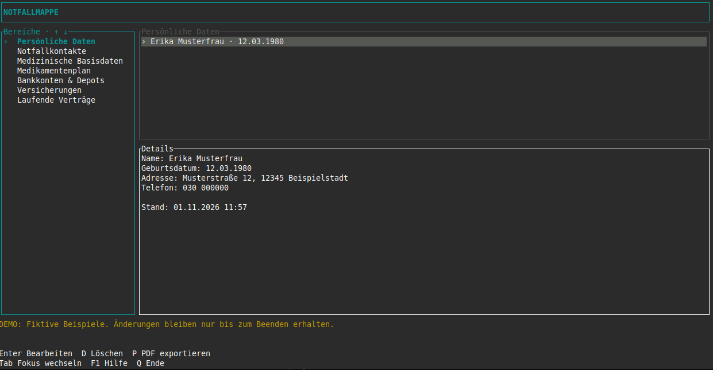

# Notfallmappen-Generator

> **Hinweis zur Entstehung:** Dieses Projekt wurde mit Unterstützung von KI erstellt.

Eine kleine Terminalanwendung, um die wichtigsten Informationen für den Notfall an einem Ort zu sammeln und als druckbare PDF zu exportieren. Geschrieben in Rust, für Linux und Windows.

Das Projekt ist noch in der **Alpha-Phase**. Funktionen und Datenformat können sich ändern. Vor einem Update die Datenbank sichern.



[Beispiel einer vollständigen Notfallmappe als PDF](docs/examples/Example_Notfallmappe.pdf)

## Was lässt sich erfassen?

- **Persönliche Daten:** Name, Geburtsdatum, Adresse und Telefon
- **Notfallkontakte:** Name, Beziehung, Telefon, E-Mail und Adresse
- **Medizinische Basisdaten:** Blutgruppe, Allergien und wichtige Erkrankungen
- **Medikamentenplan:** Medikament, Stärke, Einnahme und Hinweise
- **Bankkonten und Depots:** Bank, Kontoart, Nummer, Inhaber und Hinweise zu Vollmachten
- **Versicherungen:** Versicherer, Art, Nummer und Aufbewahrungsort der Unterlagen
- **Laufende Verträge:** Anbieter, Vertragsart, Nummer und Hinweise

Die Felder sind bewusst knapp gehalten. Persönliche und medizinische Basisdaten haben jeweils einen Datensatz, die anderen Bereiche erlauben mehrere Einträge. Allergien und Erkrankungen lassen sich als Stichpunkte erfassen.

Vorsorgevollmacht, Patientenverfügung, Betreuungs- und Sorgerechtsverfügung sowie Hinweise zum Testament sind für später vorgesehen.

## Starten

Die fertigen Pakete für **Linux x86_64** und **Windows x86_64** gibt es unter [Releases](https://github.com/BBMBB/notfallmappen-generator/releases). Das passende Archiv entpacken und die Anwendung in einem Terminal starten. Ein beschreibbarer Ordner im eigenen Benutzerverzeichnis eignet sich dafür.

Linux:

```sh
chmod +x notfallmappe
./notfallmappe
```

Windows, in PowerShell:

```powershell
.\notfallmappe.exe
```

Die Linux-Binaries werden auf Ubuntu 22.04 gebaut und benötigen glibc ab Version 2.35. Sie sind nicht für musl-Systeme wie Alpine gedacht. Unter Windows wird eine aktuelle Windows-Version mit Windows Terminal empfohlen. SQLite und die PDF-Schriften sind eingebunden; LaTeX wird nicht benötigt.

### Erst einmal ausprobieren

```sh
./notfallmappe --demo
```

Unter Windows entsprechend `.\notfallmappe.exe --demo` verwenden.

Die Demo enthält einen Beispieldatensatz je Basisdatenbereich, drei Einträge je Liste und drei Stichpunkte für Allergien und Erkrankungen. Alles lässt sich bearbeiten und als PDF exportieren. Die Demo läuft nur im Arbeitsspeicher: Nach dem Beenden sind die Änderungen weg, die eigene Datenbank bleibt unberührt.

## Bedienung

| Taste | Aktion |
| --- | --- |
| ↑ / ↓ | Links den Bereich, rechts den Eintrag auswählen |
| Tab / ← / → | Zwischen Bereichsauswahl und Eintragsliste wechseln |
| Enter | Ausgewählten Eintrag oder Basisdaten bearbeiten |
| N | Neuen Eintrag anlegen, sofern der Bereich mehrere Einträge erlaubt |
| D | Eintrag löschen, anschließend mit J bestätigen |
| P | PDF exportieren |
| F1 | Hilfe und Speicherort der Datenbank anzeigen |
| Q | Anwendung beenden |

Im Formular wechselt Tab das Feld. F2 oder Strg+S speichert, Esc bricht ab. Bei Allergien und Erkrankungen fügt Enter einen weiteren Stichpunkt hinzu. Alle Felder sind optional; ein vollständig leerer Eintrag wird nicht gespeichert. Geburtsdatum und E-Mail werden beim Speichern auf ein gültiges Format geprüft.

## PDF-Export

Die PDF enthält ein Deckblatt, ein anklickbares Inhaltsverzeichnis und Lesezeichen. Jeder der sieben Bereiche beginnt auf einer neuen Seite. Das Format ist A4 mit 20 mm Rand, eingebetteter Liberation Sans und mittiger Seitenangabe am unteren Rand, etwa „Seite 01/09“.

Mit P landet der Export im aktuellen Arbeitsverzeichnis. Bestehende Dateien werden nicht überschrieben. Zum Drucken die PDF im PDF-Programm öffnen.

Ein Export ist auch ohne TUI möglich:

```sh
./notfallmappe --db ./notfallmappe.sqlite3 --export ./meine-notfallmappe.pdf
```

Nur eine Beispiel-PDF erzeugen:

```sh
./notfallmappe --demo-pdf ./beispiel.pdf
```

## Wo liegen die Daten?

Die SQLite-Datei `notfallmappe.sqlite3` liegt standardmäßig neben der ausführbaren Anwendung. Ein anderer Speicherort ist mit `--db` möglich:

```sh
./notfallmappe --db /pfad/zur/notfallmappe.sqlite3
```

**Datenbank und PDFs sind unverschlüsselt.** Keine Passwörter oder Zugangsdaten eintragen. Unter Linux werden neue Dateien mit Zugriff nur für den eigenen Benutzer angelegt; unter Windows gelten die Berechtigungen des Ordners.

Für eine Sicherung die Anwendung schließen und die Datenbankdatei an einen geschützten Ort kopieren. Eine Sicherung kann direkt mit `--db` geöffnet werden. PDFs enthalten den Stand zum Exportzeitpunkt und müssen nach Änderungen neu erzeugt werden.

Eine Datenbank aus einer frühen Version unter `~/.local/share/notfallmappe/` wird nicht automatisch verschoben. Sie lässt sich neben die Anwendung kopieren oder mit `--db` öffnen. Das frühere gemeinsame Feld für E-Mail und Adresse wird beim Öffnen aufgeteilt: Inhalte mit @ werden als E-Mail übernommen, andere als Adresse. Gemischte Altinhalte bitte nachsehen.

## Selbst bauen

Benötigt werden eine aktuelle stabile Rust-Toolchain und ein C-Compiler für das eingebundene SQLite. Unter Linux reichen die üblichen Build-Werkzeuge, unter Windows die Visual Studio Build Tools mit „Desktopentwicklung mit C++“ und Windows SDK.

```sh
git clone https://github.com/BBMBB/notfallmappen-generator.git
cd notfallmappen-generator
cargo build --release --locked
```

Das Ergebnis liegt in `target/release/notfallmappe` beziehungsweise `target/release/notfallmappe.exe`. Alternativ startet `cargo run --release -- --demo` direkt die Demo. Bei diesem Aufruf liegt die reguläre Datenbank ebenfalls unter `target/release/`.

Prüfungen für die Entwicklung:

```sh
cargo fmt --check
cargo clippy --locked --all-targets -- -D warnings
cargo test --locked
```

GitHub Actions führt die Prüfungen auf Linux und Windows aus. Alpha-Tags bauen zusätzlich Pakete für beide x86_64-Plattformen und veröffentlichen sie mit SHA-256-Prüfsummen als Vorabversion.

## Lizenz

Der Anwendungscode steht unter der [MIT-Lizenz](LICENSE). Für die eingebetteten Liberation-Schriften gilt die [SIL Open Font License](assets/FONT-LICENSE.txt). Abhängigkeiten behalten ihre jeweiligen Lizenzen.
